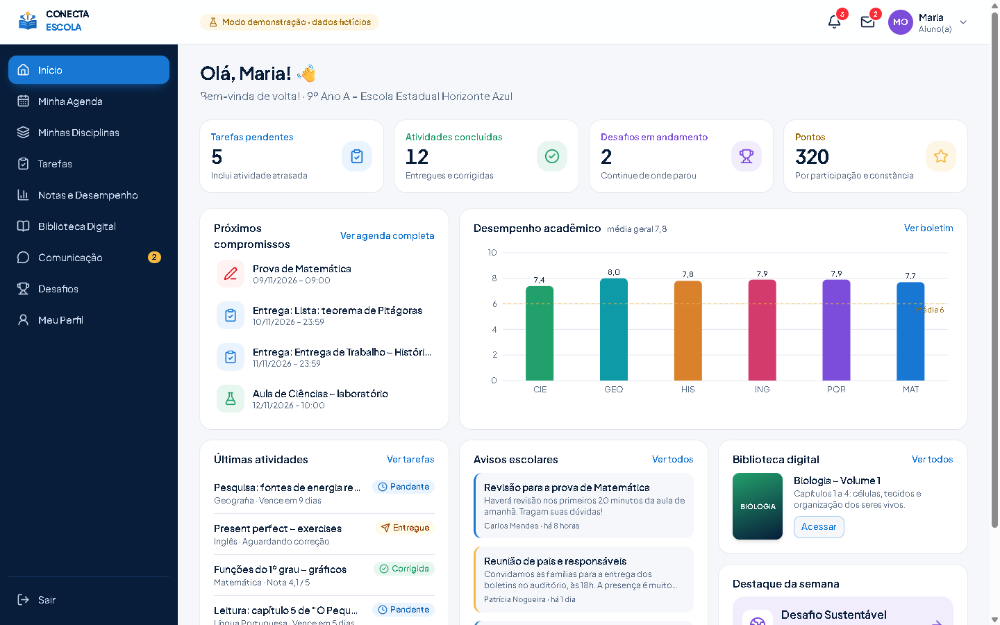
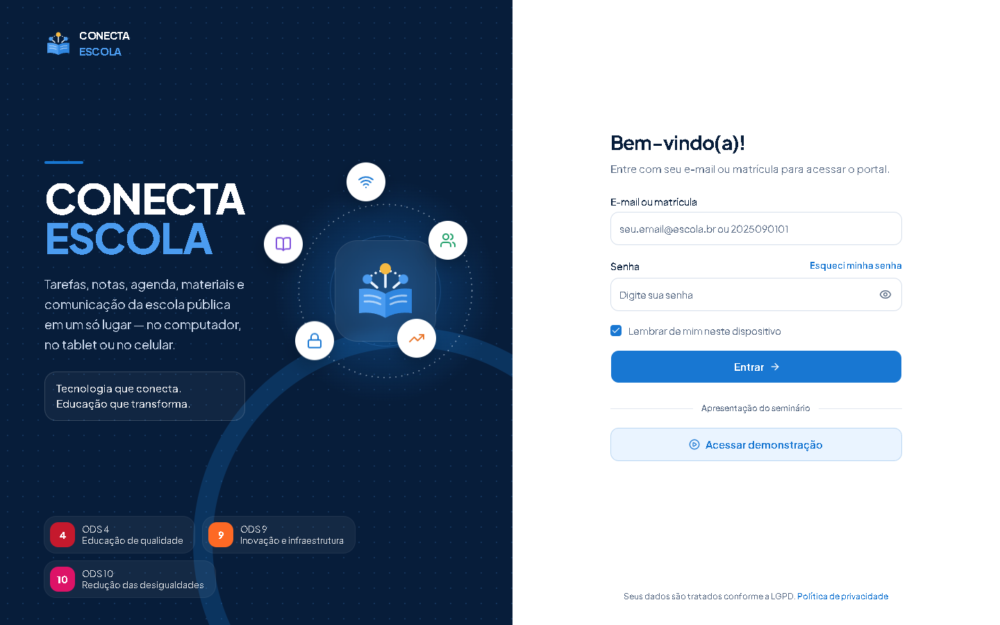
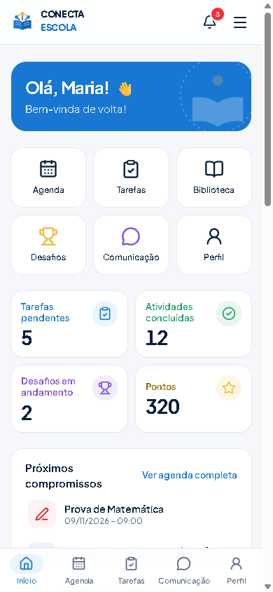
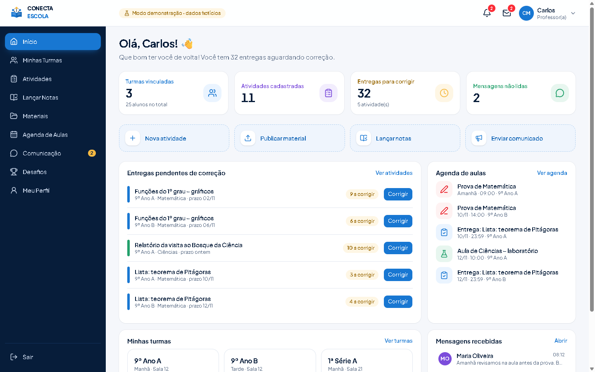
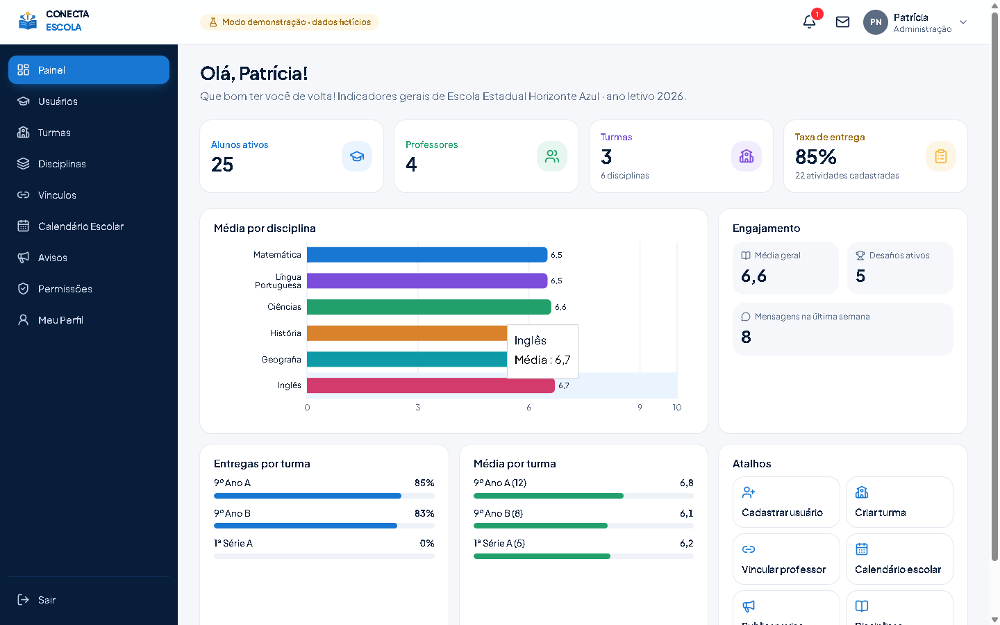

# Conecta Escola

> **Tecnologia que conecta. Educação que transforma.**

Plataforma web de acompanhamento escolar para alunos, professores e gestão de escolas públicas — tarefas, notas, agenda, biblioteca digital, comunicação e desafios gamificados em um só lugar, no computador, tablet ou celular.

Projeto do seminário de **Engenharia de Software** alinhado aos ODS **4** (educação de qualidade), **9** (inovação) e **10** (redução das desigualdades).



| Login | Celular | Professor | Administração |
|---|---|---|---|
|  |  |  |  |

---

## Começando em 1 minuto (modo demonstração)

Requisitos: **Node.js 20.9+** (testado no Node 24) e npm.

```bash
npm install
npm run dev
```

Abra <http://localhost:3000> → **Acessar demonstração** → escolha **Aluno(a)**, **Professor(a)** ou **Administração**.

Sem nenhuma configuração, o app roda em **modo demonstração**: dados 100% fictícios, salvos apenas no navegador (`localStorage`). Tudo funciona — criar atividades, entregar, corrigir, lançar notas, conversar, jogar quizzes. Para recomeçar do zero: menu do usuário → **Restaurar dados de demonstração**.

Também é possível entrar pelo formulário:

| Perfil | E-mail | Matrícula | Senha |
|---|---|---|---|
| Aluna (Maria Oliveira, 9º Ano A) | `maria.oliveira@demo.conectaescola.app` | `2025090101` | `Demo@2025` |
| Professor (Carlos Mendes) | `carlos.mendes@demo.conectaescola.app` | `PROF-0412` | `Demo@2025` |
| Administração (Patrícia Nogueira) | `patricia.nogueira@demo.conectaescola.app` | `ADM-0007` | `Demo@2025` |

### Roteiro sugerido para a apresentação

1. **Login** → validações, mostrar/ocultar senha e o acesso de demonstração.
2. **Aluna**: painel (5 pendentes, 12 concluídas, 2 desafios, 320 pontos) → Tarefas → enviar uma resposta.
3. **Professor**: Atividades → abrir a entrega da Maria → **Corrigir**. Criar uma atividade nova.
4. **Aluna** de novo: ver a nota, a notificação no sino e responder o professor em Comunicação.
5. **Desafios**: jogar o Quiz de Matemática (os pontos premiam a participação, não o acerto).
6. **Administração**: indicadores, cadastrar um aluno, vincular professor, matriz de **Permissões**.
7. Redimensionar a janela (ou abrir no celular) para mostrar a navegação inferior.

---

## Funcionalidades

**Aluno** — painel com indicadores clicáveis · agenda mensal/semanal com filtros · disciplinas com média, tarefas e materiais · tarefas com envio de texto/arquivo e correção · boletim por bimestre com gráficos · biblioteca com busca, filtros, visualização e download autorizado · mensagens com professores e avisos · desafios (quiz, leitura, sustentabilidade, ciências, metas) com pontos, medalhas e meta coletiva da turma · perfil com foto, pronome de tratamento e troca de senha.

**Professor** — painel (turmas, alunos, atividades, entregas a corrigir, agenda, mensagens) · turmas com lista de alunos e desempenho · cadastro/edição de atividades (rascunho ou publicada, anexo) · correção com nota e comentário · lançamento de notas em grade por bimestre · publicação de materiais · agenda das turmas · comunicados · criação de desafios.

**Administração** — indicadores gerais · cadastro de alunos, professores e gestão · ativar/desativar acesso · turmas · disciplinas · vínculos professor × turma × disciplina · calendário escolar · avisos institucionais · mensagens com alunos e professores · matriz de permissões e configurações da escola.

**Transversal** — notificações (sino), mensagens não lidas, estados de carregamento, vazios e de erro, toasts de sucesso/erro, layout responsivo (menu lateral no desktop, navegação inferior + menu no celular), acessibilidade (rótulos, foco visível, navegação por teclado, "pular para o conteúdo", descrição textual dos gráficos, `prefers-reduced-motion`).

---

## Tecnologias

Next.js 16 (App Router, Turbopack) · React 19 · TypeScript · Tailwind CSS 4 · shadcn/ui (Radix) · Lucide · TanStack Query · React Hook Form + Zod · Recharts · date-fns · Supabase (Auth, PostgreSQL, Storage, RLS) · Vitest.

## Arquitetura

```
src/
├─ app/                      rotas (App Router)
│  ├─ login, esqueci-senha, redefinir-senha, privacidade
│  ├─ aluno/ professor/ admin/   uma área por perfil (layout protegido)
│  └─ api/admin/users        criação de logins (service role, só no servidor)
├─ components/
│  ├─ ui/                    shadcn/ui
│  ├─ layout/                AppShell (menu lateral, cabeçalho, navegação inferior)
│  ├─ features/              módulos reutilizados entre perfis (agenda, biblioteca,
│  │                         comunicação, atividades, desafios, perfil)
│  └─ shared/                cards, estados, badges, formulários
├─ lib/
│  ├─ data/repository.ts     CONTRATO único de dados (as telas só conhecem isto)
│  ├─ demo/                  implementação demo (localStorage) + dados fictícios
│  ├─ data/supabase-repository.ts  implementação real (Supabase)
│  └─ config.ts              escolhe o modo (demo | supabase)
└─ proxy.ts                  redirecionamento por perfil antes de renderizar
supabase/
├─ migrations/               0001 esquema · 0002 RLS · 0003 funções, gatilhos e RPCs
└─ tests/                    testes automatizados das políticas de segurança
```

**Por que um repositório?** As telas chamam `getRepository().listActivities()` sem saber de onde vêm os dados. No modo demo, a implementação aplica as regras de permissão em TypeScript; no Supabase, as leituras recebem apenas o que o **RLS** libera para o usuário e as escritas passam pelo banco, que valida tudo. Trocar de modo não muda nenhuma tela.

**Defesa em camadas**: (1) `proxy.ts` redireciona por perfil no servidor; (2) `RoleGate` impede renderizar a área de outro perfil; (3) a camada de dados/RLS recusa a operação. Esconder um botão nunca é a única proteção.

---

## Conectando ao Supabase (produção)

1. Crie um projeto em <https://supabase.com>.
2. Aplique as migrations **em ordem** (SQL Editor, ou `supabase link` + `supabase db push`):
   `supabase/migrations/0001_schema.sql` → `0002_rls.sql` → `0003_functions.sql`.
3. Em **Authentication → Providers → Email**, desative **Allow new users to sign up** (contas são criadas só pela administração). Em **URL Configuration**, defina o *Site URL* e adicione `https://SEU-DOMINIO/redefinir-senha` às *Redirect URLs*.
4. Copie `.env.example` para `.env.local` e preencha (Project Settings → API):
   ```env
   NEXT_PUBLIC_SUPABASE_URL=https://xxxx.supabase.co
   NEXT_PUBLIC_SUPABASE_ANON_KEY=...
   SUPABASE_SERVICE_ROLE_KEY=...   # só no servidor; nunca com NEXT_PUBLIC_
   ```
5. **Primeiro administrador** — escolha uma opção:
   - *Homologação*: `npm run db:seed` cria toda a escola fictícia (30 logins, senha `Demo@2025`). O script se recusa a rodar se já houver perfis.
   - *Escola real*: crie o usuário em Authentication → Users e insira a escola, `school_settings` e o perfil `admin` pelo SQL Editor (exemplo abaixo). Depois, cadastre os demais pelo painel.
   ```sql
   insert into schools (name, city) values ('Minha Escola', 'Cidade – UF') returning id;
   insert into school_settings (school_id) values ('<id-da-escola>');
   insert into profiles (id, school_id, role, name, email, matricula)
   values ('<id-do-usuário-no-auth>', '<id-da-escola>', 'admin', 'Nome Completo', 'email@escola.br', 'ADM-001');
   ```
6. `npm run build && npm start`. Com as variáveis definidas, o app entra em **modo Supabase**: o botão de demonstração desaparece e o cookie de demonstração é ignorado.

Na Vercel: cadastre as mesmas variáveis em *Settings → Environment Variables* (a `SUPABASE_SERVICE_ROLE_KEY` sem o prefixo público).

### Testando o banco

```bash
npm run db:test   # PostgreSQL descartável no Docker: aplica as migrations e roda 19 verificações de RLS
```

O teste confirma, entre outros: aluno vê só os próprios dados; professor só as turmas que leciona; aluno não lança nota nem altera o próprio perfil de acesso; gabarito do quiz inacessível; pontos só via RPC (uma única vez); conversas restritas aos vínculos; admin gerencia a escola, mas não altera notas; notificações geradas por gatilhos.

Para um Supabase completo local (Auth + Storage), há `supabase/config.toml` (portas 554xx, auto-cadastro desligado): `npx supabase start`.

---

## Scripts

| Comando | O que faz |
|---|---|
| `npm run dev` | servidor de desenvolvimento (porta 3000) |
| `npm run build` / `npm start` | build e servidor de produção |
| `npm run check` | TypeScript + ESLint + testes unitários |
| `npm test` | testes unitários (Vitest) das regras de permissão e fluxos |
| `npm run db:test` | valida migrations + RLS num PostgreSQL via Docker |
| `npm run db:seed` | popula um projeto Supabase com os dados fictícios (usa `.env.local`) |
| `npm run materiais:gerar` | regenera os PDFs fictícios da biblioteca em `public/materiais` |

---

## Segurança e LGPD

- **Senhas**: no Supabase, gerenciadas pelo Supabase Auth (nunca nas tabelas). No modo demo, guardadas como hash PBKDF2-SHA256 com salt; o código não contém senhas em texto simples. Bloqueio temporário após 5 tentativas erradas (demo) / rate limit do Supabase.
- **Credenciais**: nenhuma chave privada no código. A *service role* é usada apenas em `src/app/api/admin/users/route.ts` e no script de seed.
- **Menor privilégio**: matriz completa em **Administração → Permissões** e em `supabase/migrations/0002_rls.sql`.
- **Crianças e adolescentes (art. 14)**: coleta mínima, responsável legal no cadastro, mensagens entre alunos desligadas por padrão e gamificação **sem ranking público** — resultados individuais ficam visíveis só ao aluno e ao professor; a turma vê apenas a meta coletiva.
- **Arquivos**: bucket privado `arquivos`, upload restrito à pasta do usuário e links assinados de curta duração.
- **Cabeçalhos HTTP**: `X-Content-Type-Options`, `X-Frame-Options`, `Referrer-Policy`, `Permissions-Policy`.
- Política de privacidade em `/privacidade`. O modo demonstração não usa dados reais de estudantes.

---

## O que foi verificado

- `npm run check`: TypeScript sem erros, ESLint sem erros, 13 testes unitários passando.
- `npm run build`: build de produção concluído (40 rotas).
- Navegador (Playwright): todas as rotas dos três perfis em desktop e em 390 px (sem rolagem horizontal); fluxo completo professor → aluno → correção → nota → mensagem → quiz.
- **Supabase real (instância local via Supabase CLI)**: migrations aplicadas, seed executado, login por e-mail e por matrícula, painel com os mesmos indicadores vindos do banco, criação de atividade, entrega, correção, quiz e checklist via RPC, mensagem, notificações por gatilho e cadastro de usuário pela rota de servidor.

## Limitações conhecidas

- **Redefinição de senha no Supabase** (`/redefinir-senha`): segue o fluxo padrão do Supabase Auth, mas não foi testada ponta a ponta com envio de e-mail.
- **"Lembrar de mim"**: controla a duração da sessão no modo demo; no Supabase a sessão é persistida pelo próprio Supabase Auth.
- **Login por matrícula** usa a função `login_email`, que converte matrícula em e-mail — isso permite descobrir o e-mail de uma matrícula. Em produção, use e-mails institucionais e mantenha o rate limit ativo.
- **Participantes dos desafios** vistos pelo aluno no modo Supabase contam apenas a própria participação (o RLS não expõe colegas); a meta coletiva usa a RPC `class_points_total`.
- **Escala**: o modo Supabase lê as tabelas permitidas em lote (até 5.000 linhas por tabela) — adequado para uma escola; para uma rede inteira, migrar para consultas paginadas por tela.
- **Tempo real**: mensagens e notificações atualizam por consulta periódica (8–15 s), sem WebSocket.
- No modo demonstração, cada navegador/dispositivo tem a sua própria cópia dos dados.

---

Projeto acadêmico. Os nomes de pessoas e da escola usados na demonstração são fictícios.
